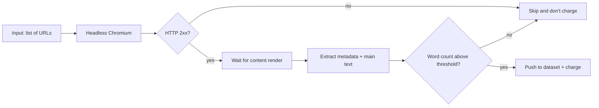

# AI Training Dataset Builder — Articles, Blogs & Web Pages → Clean JSON for LLMs

[](https://apify.com/Turboextract/ai-training-dataset-builder)
[](LICENSE)
[](#pricing)

**Turn any list of URLs into clean, structured training data for AI models, RAG pipelines, and LLM fine-tuning.** Built for ML engineers, AI researchers, and dataset teams who need reliable web content at scale without writing a custom scraper for every site.

> One tool. Any URL list. Clean JSON with title, author, publish date, body text, language, and word count. Pay only for pages that succeed.

**Try it now →** [apify.com/Turboextract/ai-training-dataset-builder](https://apify.com/Turboextract/ai-training-dataset-builder)

---

## Why this exists

Building a training corpus or a RAG knowledge base means scraping articles. Doing it well means handling JavaScript-rendered SPAs, bot-detection, lazy-loaded content, paywalls, cookie banners, and HTTP errors — for every site, individually.

This actor replaces that work with a single, opinionated extractor:

- **Headless Chromium** via Playwright handles JS-heavy and SPA pages
- **Semantic HTML extraction** — pulls `article`, `main`, `[role=main]`, `[itemprop=articleBody]` first; falls back gracefully
- **Word-count gating** so you don't pay for thin or 404 pages
- **Normalized JSON output** ready for vector stores, fine-tuning datasets, or content audits

If you currently maintain hand-rolled scrapers per site, this replaces all of them with one tool.

---

## Who this is for

- **AI / ML engineers** building training corpora for LLMs and small language models
- **RAG developers** populating vector stores with fresh, structured content
- **Dataset curators** assembling fine-tuning sets from public web sources
- **Content intelligence teams** monitoring articles, blogs, and editorial pages
- **Researchers** harvesting public web pages for analysis at scale
- **Founders** prototyping AI products that need a real-world web corpus fast

---

## What you get per URL

```json
{
  "url": "https://example.com/article",
  "title": "How Retrieval Augmented Generation Works",
  "description": "A practical guide to RAG architectures.",
  "author": "Jane Doe",
  "publishedAt": "2026-04-12T08:30:00Z",
  "language": "en",
  "wordCount": 1842,
  "text": "Retrieval augmented generation combines a retriever with a generator...",
  "scrapedAt": "2026-05-04T14:02:11Z"
}
```

Every field is normalized. Empty pages, 404s, and thin content (under 50 words by default) are skipped automatically so your dataset stays clean. See [`examples/sample-output.json`](examples/sample-output.json) for real output from a live run.

---

## How it works



Behind the scenes:

1. Playwright opens each URL in a real Chromium browser with `--disable-blink-features=AutomationControlled`
2. Waits for `domcontentloaded`, then `networkidle` (15s cap), then polls `document.body.innerText` until substantive content renders
3. Extracts the longest semantic block from a candidate selector list (`article`, `main`, `[role=main]`, `[itemprop=articleBody]`, post/entry/article-content classes, body fallback)
4. Reads metadata: `og:title`, `og:description`, `meta[name=author]`, `time[datetime]`, `<html lang>`
5. Skips pages with HTTP 4xx/5xx and pages below `minWordCount` — neither lands in your dataset, neither charges
6. Pushes one normalized JSON item per successful page to the run's dataset

No DOM tweaking, no per-site config. The extractor is designed for the long tail of blogs and editorial sites.

---

## Quick start

### From the Apify Console (no code)

1. Open [the actor page](https://apify.com/Turboextract/ai-training-dataset-builder)
2. Click **Try for free**
3. Paste your URLs
4. Click **Start**
5. Download the dataset as JSON, CSV, Excel, or stream it to your pipeline

### From the API ([curl](examples/curl.sh))

```bash
curl -X POST "https://api.apify.com/v2/acts/Turboextract~ai-training-dataset-builder/runs?token=YOUR_TOKEN" \
  -H "Content-Type: application/json" \
  -d '{
    "startUrls": [
      { "url": "https://blog.apify.com/web-scraping-report-2026/" },
      { "url": "https://en.wikipedia.org/wiki/Retrieval-augmented_generation" }
    ],
    "maxPages": 100,
    "minWordCount": 50,
    "includeImages": false
  }'
```

### From Python ([full example](examples/python.py))

```python
from apify_client import ApifyClient

client = ApifyClient("YOUR_TOKEN")
run = client.actor("Turboextract/ai-training-dataset-builder").call(run_input={
    "startUrls": [{"url": "https://example.com/post"}],
    "maxPages": 500,
})
for item in client.dataset(run["defaultDatasetId"]).iterate_items():
    print(item["title"], item["wordCount"])
```

### From Node.js ([full example](examples/node.mjs))

```js
import { ApifyClient } from 'apify-client';

const client = new ApifyClient({ token: 'YOUR_TOKEN' });
const run = await client.actor('Turboextract/ai-training-dataset-builder').call({
    startUrls: [{ url: 'https://example.com/post' }],
    maxPages: 500,
});
const { items } = await client.dataset(run.defaultDatasetId).listItems();
console.log(items.length);
```

---

## Input fields

| Field | Type | Default | Description |
|---|---|---|---|
| `startUrls` | array | required | URLs of articles, blog posts, or web pages to process |
| `maxPages` | integer | 100 | Safety cap on pages processed per run |
| `includeImages` | boolean | false | Attach image URLs from inside the article body |
| `minWordCount` | integer | 50 | Skip pages below this word count (filters thin or empty pages) |

---

## Pricing

**Pay per page processed. No subscriptions.**

| Volume | Price per page | Total |
|---|---|---|
| First 50 pages (free tier) | $0.000 | $0.00 |
| Per page after that | $0.005 | 1,000 pages = $5 |
| 10,000 pages | $0.005 | $50 |

You only pay for pages that return clean content above your `minWordCount`. Thin pages, blocked pages, 4xx errors, and failed loads cost nothing.

### How it compares

| Tool | Pricing model | 1,000 pages |
|---|---|---|
| **AI Training Dataset Builder** | $0.005 per page | **$5** |
| Apify Web Content Crawler | Per result + compute | $7 to $15 |
| Diffbot Article API | $299 per month base | $300+ |
| Custom in-house scraper | Engineer time | $500+ build cost |

For a 10,000-page corpus the savings versus Diffbot is roughly $250 in your first month, $300/month thereafter.

---

## Common use cases

- **LLM fine-tuning datasets** from public blogs, documentation sites, and editorial archives
- **RAG knowledge bases** populated from a curated URL list, refreshed on a schedule
- **Competitive content audits** comparing publish cadence and word count across competitors
- **Academic and journalistic research** assembling source corpora across many domains
- **AI startup data ingestion** — get a defensible content moat without paying enterprise API rates
- **Content moderation training** — bulk-collect labeled examples from known-good and known-bad sources

---

## Tips for best results

- Start with 10 to 20 URLs to verify extraction quality on your target sites
- Set `minWordCount` higher (200 to 500) if you only want long-form content
- Use `maxPages` as a hard safety cap on every run
- Schedule the actor weekly to keep your training data fresh
- For a full-site crawl, pair with a sitemap discovery step before this actor

---

## Pairs well with

- **Reddit Brand Monitor & Lead Finder** — pair article harvesting with social signals
- **Website Lead Extractor** — turn the same URL list into a B2B contact dataset
- **Lead Enrichment Pipeline** — chain extractors together for multi-source enrichment

(Links updated as related actors ship.)

---

## FAQ

**Does it handle JavaScript-rendered pages?**
Yes. The actor uses headless Chromium via Playwright, so SPAs, JS-heavy sites, and lazy-hydrated Webflow / HubSpot pages all work the same as static HTML. There's an explicit content-render wait that polls `document.body.innerText` until substantive text exists.

**What about paywalls and login walls?**
The actor reads what an unauthenticated browser sees. Paywalled content is not bypassed.

**How is this different from a generic web scraper?**
Output is normalized for AI use cases: cleaned body text (not raw HTML), word count, language, ISO publish date, and metadata. You can pipe it straight into a vector store or training pipeline. Generic scrapers leave you to extract the article body yourself.

**Can I run this on a schedule?**
Yes. Apify's built-in scheduler runs the actor on any cron expression. Pair it with a webhook to ship new items into your store of choice.

**What if a page fails or returns 404?**
Failed pages and 4xx/5xx responses are logged and skipped. You are not charged. The dataset only contains pages that returned 2xx and produced content above your word-count threshold.

**Does this respect robots.txt?**
The actor reads the URLs you specify directly. You're responsible for compliance with each site's terms and robots directives.

**What's the output format?**
JSON by default. The Apify dataset API can also export as CSV, Excel, RSS, JSONL, or HTML.

**Is the source code public?**
The actor itself runs on Apify's platform. This repo contains documentation, working examples, and the JSON schema — not the actor's internal scraper logic.

---

## SEO keywords

For visitors who arrived here from search: this tool is also referred to as a **web scraper for AI training data**, a **blog-to-JSON converter**, an **LLM fine-tuning dataset generator**, a **RAG content harvester**, an **article extraction API**, an **LLM training corpus builder**, and a **structured web data extractor**.

---

## Support

- Open an issue on this repo for bug reports — please include the failing URL
- Actor page on Apify: [apify.com/Turboextract/ai-training-dataset-builder](https://apify.com/Turboextract/ai-training-dataset-builder)
- Community Discord: [discord.gg/8SrXSCpvgj](https://discord.gg/8SrXSCpvgj) - updates, support and feature requests
- Maintained by [Turboextract](https://apify.com/Turboextract) on the Apify platform

## License

[MIT](LICENSE) — examples and documentation. The actor itself is hosted on Apify under their platform terms.
